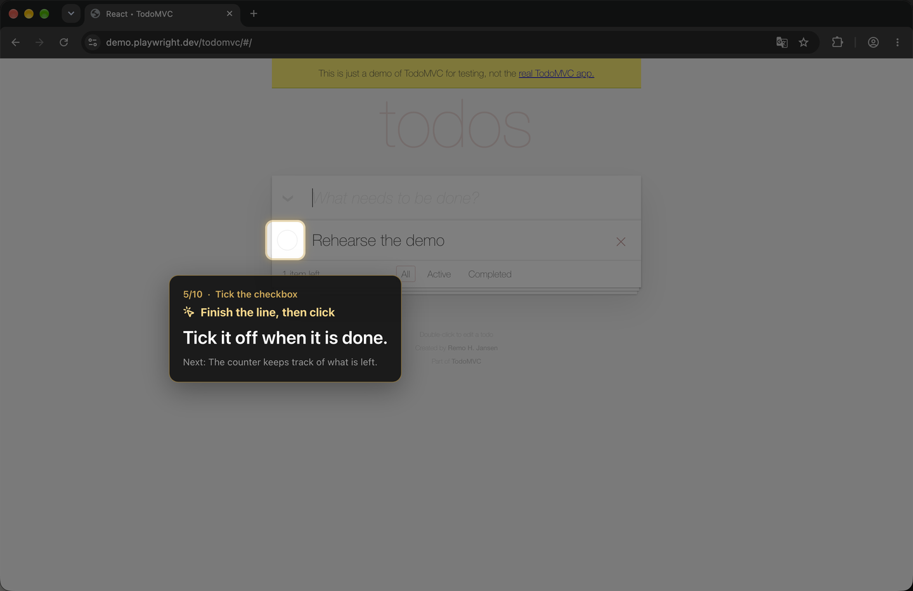
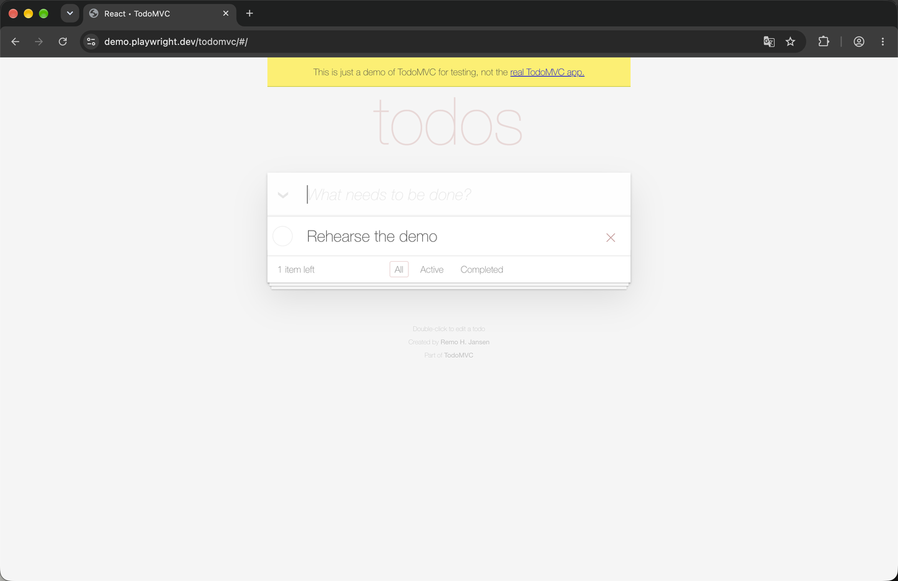
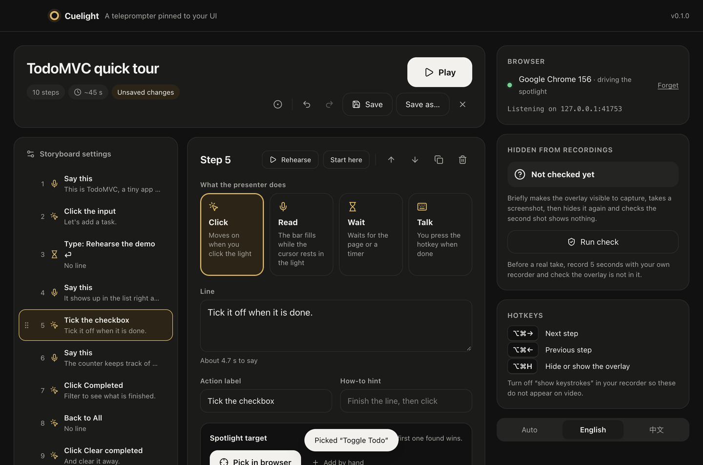
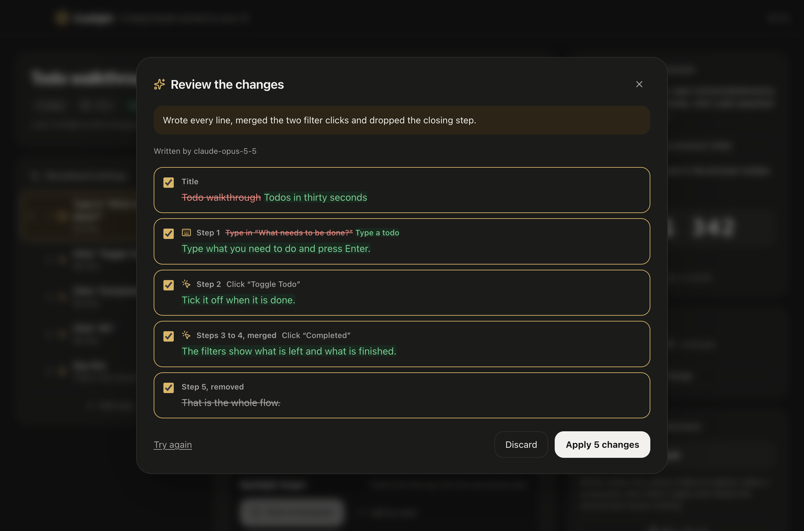
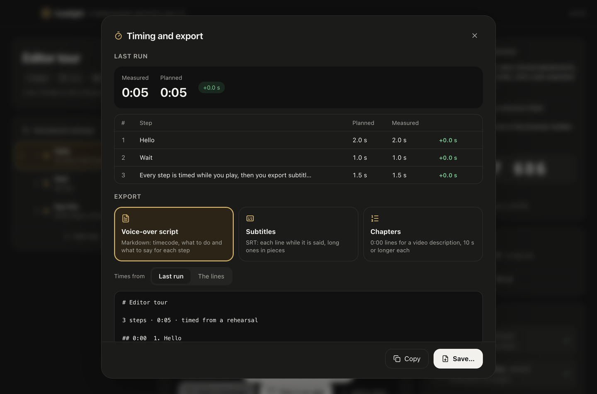
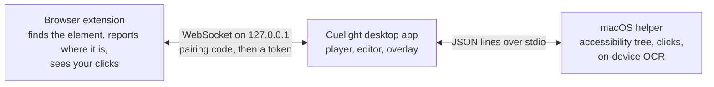

<p align="center"></p>

<h1 align="center">Cuelight</h1>

<p align="center">A teleprompter pinned to your UI.<br>Spotlight on the next click, your line right next to it, invisible to screen recorders.</p>

| What you see while presenting | What the recording gets, same moment |
|---|---|
|  |  |

The right-hand picture is a real screenshot of the same moment, taken by macOS's own capture tool. The light and the card are drawn in windows the system leaves out of every capture.

You still do the clicking and the talking. Cuelight is the friend behind the camera holding up cue cards, except the cards are stuck to the buttons, and they know when you have clicked.

## Why you might like it

- Your line sits next to the thing you click. Ordinary prompters scroll on a timer or follow your voice and have no idea what is on screen. Here a real click moves the show forward.
- It coaches the delivery, not just the words. Every card says how to play the step: finish the line and then click, just click, or rest the cursor in the light and talk. A read bar fills as you speak and the next line peeks in at the bottom.
- Works with whatever records you. Screen Studio, OBS, QuickTime, Loom or a meeting share. Cuelight never records anything itself, and a built-in self-test checks the overlay stays out of your captures.
- Runs in your everyday browser. The extension lives in your own Chrome or Edge, so logins, bot checks and localhost dev servers just work. No automated browser, no webdriver flag.
- Desktop apps too. On macOS a small helper finds buttons in any app through the accessibility tree, or text on screen with on-device OCR.
- Writes its own first draft. Click through your demo once and get the steps. Then let an AI model of your choice write the lines, and keep only the changes you like.
- Knows how long it takes. Every rehearsal is timed step by step, and the storyboard exports as a voice-over script, subtitles or chapter marks.
- Speaks English and Simplified Chinese.
- MIT licensed.

## Quick start

You need macOS 14 or later, Node 22.12 or newer, pnpm 11, and Chrome or Edge. Targets in desktop apps also need the Xcode Command Line Tools.

```bash
pnpm install
```

`pnpm install` fetches the Electron binary. If your default npm registry is an unreachable mirror, add `--registry=https://registry.npmjs.org/`.

Build the macOS helper (optional, for desktop apps) and the extension, then start the app:

```bash
pnpm helper
```

```bash
pnpm --filter @cuelight/extension build
```

```bash
pnpm dev
```

Load the extension once:

1. Open `chrome://extensions` (or `edge://extensions`) and turn on Developer mode.
2. Click Load unpacked and pick `apps/extension/dist`.
3. Click the Cuelight icon in the toolbar and type the 6-digit code shown in the app. You only pair once.

Now open the TodoMVC example and press Play. Your browser tab goes to the demo page, a short preroll card waits for you to start your recorder, and ⌥⌘→ begins the show.

## Your first take

Every step is one of four kinds. The card tells you which, so you never have to remember.

| Step | What you do | It moves on when |
|---|---|---|
| Click | Say the line, then click the element in the light | You click inside the light |
| Read | Rest the cursor in the light and talk | The read bar is full (it only fills while the cursor is in the light) |
| Wait | Do what the card says: type something, wait for a page | The page shows what the step waits for, or its timer runs out |
| Talk | Talk, then press the hotkey | You press ⌥⌘→ |

| Keys (macOS) | Keys (Windows, Linux) | Action |
|---|---|---|
| ⌥⌘→ | Ctrl+Alt+→ | Next step |
| ⌥⌘← | Ctrl+Alt+← | Previous step |
| ⌥⌘H | Ctrl+Alt+H | Hide or show the overlay |

The hotkeys only exist while a storyboard is playing. If your recorder shows keystrokes on screen, turn that off, or your audience will see every ⌥⌘→.

A few things it handles for you:

- If the element is scrolled out of view, the light becomes a strip at that edge with a scroll hint, and jumps onto the element as soon as you scroll to it.
- If the page is still loading or the element is gone, the card says so instead of pointing at nothing.
- Read time is about two English words per second (a CJK character counts as half a word), plus 1.2 seconds, and at least 2.5 seconds. A storyboard can change the pace.

## Writing a storyboard



The editor has the steps on the left (drag to reorder) and the selected step on the right. ⌘Z and ⇧⌘Z undo and redo everything.

- Pick in browser. Click the element in your own browser and it becomes the step's target. The page never sees that click. ↑ widens the pick to the parent element, ↓ narrows it back, Enter picks, Esc cancels. Cuelight writes a short fallback chain (test id, ARIA role and name, id, visible text, CSS) and checks every entry leads back to the same element.
- Pick in an app. The same, for a button in any macOS app.
- Record a run. Click through your demo once in the browser and get the steps drafted: clicks become click steps with their targets, typing becomes wait steps, page changes are followed. The text you type is only kept if you tick the box, and never for passwords, card numbers or one-time codes.
- Rehearse plays just this step. Start here plays from it.
- The brief (product, audience, tone, target length) helps whoever writes the lines, you or the AI.

## Let an AI write the lines



Write with AI drafts every line from the steps, or rewrites one step. Quick chips cover the usual asks: shorter, friendlier, or translated. The answer comes back as changes you take or leave one by one, with a word-level diff, and ⌘Z undoes them.

Bring your own model:

| Service | Address | Key |
|---|---|---|
| Anthropic | `https://api.anthropic.com`, Claude Opus 5.5 by default | Required |
| OpenAI | `https://api.openai.com/v1` | Required |
| OpenAI-compatible | Any base URL: DeepSeek, Volcano Ark, your own gateway | Only if the service asks |
| Ollama | `http://127.0.0.1:11434/v1`, models on this computer | None |

- Keys are encrypted with the system keychain and never written into storyboards. Where the system cannot encrypt, a key is kept in memory until Cuelight quits.
- Only the storyboard you are writing for is sent, and only to the service you picked.
- The answer is checked against a schema, and a model that gets it wrong is asked to fix it once before you see anything.
- On the Claude API, models that support server-side fallbacks are asked with them turned on, so a busy model can be stood in for. The review sheet always names the model that actually wrote the lines.
- The AI settings take a proxy address; empty uses the system proxy.

## Desktop apps (macOS)

Targets outside the browser go through `cuelight-helper`, a small Swift program in `apps/helper-mac`. `pnpm helper` builds it for both Apple silicon and Intel, and the packaged app carries its own copy.

It needs two permissions. The Desktop apps tile in Cuelight shows both, and nothing is asked until you press Allow:

| Permission | What it is for |
|---|---|
| Accessibility | Finding buttons and fields in apps, picking them, and seeing your clicks |
| Screen Recording | Finding text on screen with on-device OCR (Apple Vision) |

Clicks are watched with a listen-only event tap, so Cuelight can see a click but never block or change it. While you pick an element in an app, exactly one click (or Esc) is taken.

You rarely write these targets by hand, since Pick in an app does it, but this is what it produces:

```json
{
  "act": "click",
  "say": "Everything we download lands here.",
  "target": [
    { "kind": "ax", "app": "com.apple.finder", "role": "AXStaticText", "title": "Downloads" },
    { "kind": "visual", "app": "com.apple.finder", "text": "Downloads" },
    { "kind": "region", "relativeTo": "window", "app": "com.apple.finder", "rect": [12, 180, 140, 22] }
  ]
}
```

The first target that resolves wins, so a precise one goes first and a looser one after it. A storyboard can also bring an app forward when it starts, with `"start": { "app": "com.apple.finder" }`.

## Timing and export



Play the whole storyboard once and every step is timed. The editor tells you if you ran long or short, and Timing and export lists each step, planned against measured.

| Export | Format | What is in it |
|---|---|---|
| Voice-over script | Markdown | Each step's timecode, what to do and what to say |
| Subtitles | SRT | Each line while it is being said. Long lines are split at sentence ends and commas and wrapped to two lines, Chinese included |
| Chapters | Text | `0:00 Title` lines for a video description, each chapter at least 10 seconds |

Times come from the last run, or from the reading pace if you have not rehearsed yet or the steps changed since.

## Storyboard format

A storyboard is a JSON file. The full schema is in [`packages/schema/storyboard.schema.json`](packages/schema/storyboard.schema.json), generated from [`packages/schema/src/storyboard.ts`](packages/schema/src/storyboard.ts), so editors that read JSON Schema can autocomplete it.

```json
{
  "$schema": "../packages/schema/storyboard.schema.json",
  "cuelight": 1,
  "title": "TodoMVC quick tour",
  "language": "en",
  "start": { "url": "https://demo.playwright.dev/todomvc/#/" },
  "steps": [
    {
      "act": "click",
      "say": "Let's add a task.",
      "target": [
        { "kind": "dom", "role": "textbox", "name": "What needs to be done?" },
        { "kind": "dom", "css": "input.new-todo" }
      ]
    },
    {
      "act": "wait",
      "how": "Type “Rehearse the demo” and press Enter",
      "until": { "appear": [{ "kind": "dom", "testId": "todo-title", "text": { "exact": "Rehearse the demo" } }] }
    }
  ]
}
```

Each step has an `act` (`click`, `read`, `wait`, or `manual` for Talk), the line to `say`, and an optional `target`. Locator kinds:

| `kind` | Finds | Works on |
|---|---|---|
| `dom` | A web element by test id, ARIA role and name, visible text or CSS, optionally `within` another element and limited to some URLs | Chrome and Edge |
| `ax` | An app element in the accessibility tree: bundle id, window title, role, title, identifier, ancestors | macOS, with Accessibility |
| `visual` | Text found on screen by OCR, with the light placed relative to it | macOS, with Screen Recording. Image templates are planned |
| `region` | A fixed rectangle on a screen, or in an app's front window, in points or fractions | Screen: everywhere. Window: macOS |
| none | No target: the card sits at the top or bottom of the screen, for talking-head parts | Everywhere |

Text matches can be a substring (`"Save"`), exact (`{ "exact": "Save" }`) or a regular expression (`{ "re": "^Save( all)?$", "flags": "i" }`).

The [`examples`](examples) folder has a TodoMVC tour, a Wikipedia tour with scrolling and page changes, and a talk-only intro.

## Hidden from recordings

Capture exclusion depends on the OS and on which capture API a recorder uses, so check it on your own machine. Open the Hidden from recordings tile and press Run check, or:

```bash
pnpm selftest
```

It draws a test pattern on every display for a moment, takes one screenshot with the overlay made capturable and another with it protected again, and compares the pixels. It passes when the pattern shows up in the first and is gone from the second.

| OS | Capture path | Result |
|---|---|---|
| macOS 27.0.1, Electron 45.2 | `screencapture` (the system screenshot tool) | Hidden |
| macOS 27.0.1, Electron 45.2 | Chromium `desktopCapturer` (what Electron and Chrome screen-share use) | Hidden |

Electron's documentation warns that on recent macOS some apps built on ScreenCaptureKit ignore content protection. Before relying on it for a particular recorder or meeting app, make a five-second test recording with that app.

## Make a package

```bash
pnpm package
```

This builds everything and leaves two files in `dist/`:

- `Cuelight-0.1.0-arm64-mac.zip`: the app, with the helper, the extension and the examples inside. Its main process is a single bundle, so there is no `node_modules` in it.
- `cuelight-extension-0.1.0.zip`: the extension, ready for a store upload.

The app is ad-hoc signed, not yet signed with a Developer ID or notarized. On first launch macOS blocks it; allow it under System Settings, Privacy & Security, Open Anyway. Each build gets a new ad-hoc signature, so macOS asks for Accessibility and Screen Recording again after a rebuild. Add `--dmg` for a disk image as well (building one mounts it for a moment).

## Development

```bash
pnpm test
```

```bash
pnpm typecheck
```

```bash
pnpm build
```

The end-to-end checks run invisibly: the app is headless, the browser is headless with the extension loaded, and the editor is driven from the script. No window appears and your mouse and keyboard are never used, so you can keep working while they run.

| Command | What it proves |
|---|---|
| `pnpm e2e todomvc` | Plays an example against its public site in a throwaway browser profile, pairs through the real popup, performs every step, and checks the light lands within 3 points of where the browser places the element |
| `pnpm e2e:editor` | Picking (and cancelling), editing, undo and redo, drag to reorder, saving, rehearsing, and recording a run into a draft |
| `pnpm e2e:ai` | The AI sheets against a local stand-in for the Anthropic and OpenAI APIs: a full draft, taking some changes, a rewrite after a wrong first answer, a rejected key, cancelling |
| `pnpm e2e:native` | The light lands on a Finder element and on a spot in its window. Needs a Finder window open and Accessibility already allowed |
| `pnpm e2e:export` | A timed run, the timing table, and all three exports saved exactly as previewed |
| `pnpm check:helper` | The helper on this Mac: permissions, window list, OCR in English and Chinese, and accessibility locators that lead back to their elements |

Useful options:

- `CHROME=/path/to/chrome` or `CHROMIUM=/path/to/chromium` picks the browser. Branded Chrome and Edge ignore `--load-extension` since version 137, so the checks install the extension through the DevTools protocol instead.
- `E2E_PROXY=http://127.0.0.1:port` if the browser needs a proxy to reach the demo sites.
- `--lang zh` runs a check with the Chinese interface.
- `--shots <dir>` saves pictures for checking by eye. The editor, AI, native and export checks render them off screen; the web check has to show its window for them.
- `pnpm e2e todomvc --headed` shows the real browser and overlay, and `--zoom 1.25` tests page zoom.

So far the web check passes on macOS 27 for both web examples in Google Chrome 156, Microsoft Edge 156 and Chrome for Testing 153, and at 125% page zoom.

App flags for development: `--open <storyboard.json>`, `--play [--from <n>]`, `--selftest [--selftest-out <dir>]` and `--log` (events as `CUELIGHT {json}` lines on stdout). `CUELIGHT_HEADLESS=1` runs the app with no windows, no Dock icon and no global hotkeys.

## How it works



- The desktop app (Electron) owns the overlay: one transparent, click-through, always-on-top window per display, with `setContentProtection(true)` (`NSWindowSharingNone` on macOS, `WDA_EXCLUDEFROMCAPTURE` on Windows 10 2004 and later).
- The extension (Manifest V3) resolves each step's target in the page and keeps reporting where it is on screen as you scroll, zoom or resize.
- They talk over a WebSocket bound to 127.0.0.1 only. The first connection needs the 6-digit code shown in the app; after that the extension keeps a token.
- The app starts the helper and sends it one JSON request per line; the helper also reports clicks and picks that way. Its screen captures leave out Cuelight's own windows.

| Path | What it is |
|---|---|
| `apps/desktop` | Electron, Vite and React: overlay, player, editor, hotkeys, local bridge, AI, self-test |
| `apps/extension` | Chromium MV3 extension: locator, picker, recorder, click detection, popup |
| `apps/helper-mac` | Swift helper for desktop apps: accessibility, clicks, OCR |
| `packages/schema` | Storyboard schema (zod and generated JSON Schema), pacing, cue strings, exports, wire protocol |
| `examples` | Storyboards you can play right away |
| `scripts` | Builds, packaging and the end-to-end checks |

## Roadmap

Done so far: the overlay and capture self-test, the extension, playback, the editor and picker, recording a run, AI writing, desktop apps on macOS, rehearsal timing, exports and an unsigned macOS package.

Next:

- Developer ID signing and notarization, so the first launch needs no trip to System Settings.
- Chrome Web Store and Edge Add-ons listings.
- Windows: desktop-app targets and packaging. The overlay and the browser side should mostly work there already, but are untested.
- Image templates for `visual` targets.
- A recorder matrix: Zoom, Teams, Meet, QuickTime, OBS, Screen Studio, Loom, Cap.

## A note on use

Cuelight is a prompter for your own talk. The overlay hides from capture so your recording looks clean, not so anyone can be misled about what you are reading. Some workplaces and exam tools detect or block capture-excluded windows.

## License

[MIT](LICENSE)
